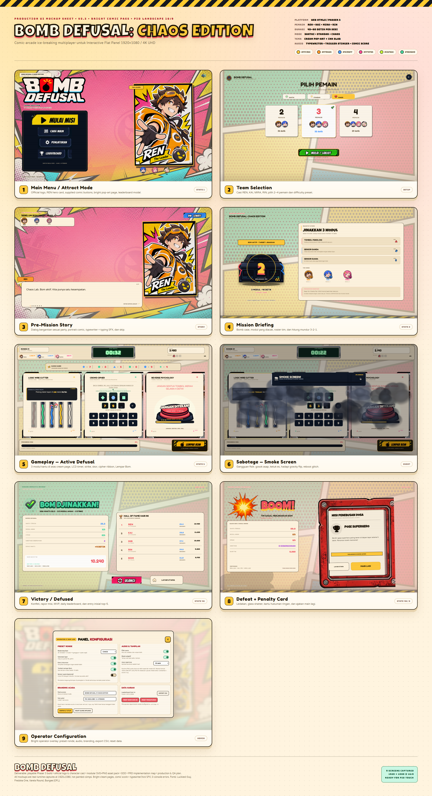

# BOMB DEFUSAL: CHAOS EDITION
### Official comic-arcade branding — multiplayer HTML5 ice-breaking for large-format PID touchscreens

A finished, playable Phaser 3 build of a 2–4 player cooperative bomb-defusal party game, designed for 1920×1080 (16:9) Interactive Flat Panels and 4K UHD panels running in landscape. One round is built to last 45–60 seconds including the 3-second briefing.



---

## Quick start (offline / event laptop)

Requirements: **Node.js 18+** and a Chromium-based browser. No internet access is required at runtime — Phaser and all fonts/assets are vendored.

```powershell
npm start
# open http://localhost:8123
```

or without npm:

```powershell
node serve.mjs 8123
```

Windows kiosk launcher (server + Chromium dedicated profile + fullscreen):

```powershell
npm run kiosk
# or
powershell -ExecutionPolicy Bypass -File .\scripts\start-kiosk.ps1
```

For a kiosk launch on Windows, see [Production Plan → PID deployment](docs/PRODUCTION_PLAN.md#pid--kiosk-deployment).

---

## What is included

| Deliverable | Location |
|---|---|
| Playable game (2–4 players, 6 puzzle modules, 4 sabotages, pass-the-bomb, scoring, leaderboards, admin) | root + `src/` |
| Official logo, comic UI kit, cast avatars, halftone page backgrounds | `assets/brand/`, `assets/ui/comic/`, `assets/characters/`, `assets/backgrounds/` |
| **Ringkasan produksi (Bahasa Indonesia)** | [`docs/RINGKASAN_PRODUKSI.md`](docs/RINGKASAN_PRODUKSI.md) |
| **Laporan UI/typography + optimasi** | [`docs/UI_OPTIMIZATION_REPORT.md`](docs/UI_OPTIMIZATION_REPORT.md) |
| Game Design Document (GDD) | [`docs/GDD.md`](docs/GDD.md) |
| Scene & systems architecture | [`docs/SCENE_ARCHITECTURE.md`](docs/SCENE_ARCHITECTURE.md) |
| UI/asset specification, pixel sizes, formats, responsive scaling | [`docs/ASSET_SPEC.md`](docs/ASSET_SPEC.md) |
| Production / implementation plan, PID deployment, QA and roadmap | [`docs/PRODUCTION_PLAN.md`](docs/PRODUCTION_PLAN.md) |
| PRD → implementation traceability map | [`docs/PRD_IMPLEMENTATION_MAP.md`](docs/PRD_IMPLEMENTATION_MAP.md) |
| QA checklist and tested flows | [`docs/QA_CHECKLIST.md`](docs/QA_CHECKLIST.md) |
| UI mockups — real runtime captures at 1920×1080 | [`docs/mockups/`](docs/mockups/) • [Overview](docs/mockups/00-overview.png) |
| Full modular SVG asset pack (175 source files) | [`assets/`](assets/) |
| Comic UI cuts, logo & cast avatars (PNG, transparent) | [`assets/ui/comic/`](assets/ui/comic/) • [`assets/brand/`](assets/brand/) • [`assets/characters/`](assets/characters/) |
| Halftone comic page backgrounds (1920×1080 PNG) | [`assets/backgrounds/`](assets/backgrounds/) |
| PNG export mirror (180 files, 1×; curated subset loaded at runtime) | [`assets/exports/`](assets/exports/) |
| Searchable asset catalogue / QA board | [`docs/asset-catalog.html`](docs/asset-catalog.html) |
| Asset JSON manifests | [`assets/asset-manifest.json`](assets/asset-manifest.json) • [`assets/exports/export-manifest.json`](assets/exports/export-manifest.json) |
| Provided art-direction reference boards | [`docs/references/`](docs/references/) |

---

## Cast

| Slot | Character | Role | Accent |
|---|---|---|---|
| P1 | **REN** | The Leader | Orange `#FF9A2A` |
| P2 | **KAI** | The Strategist | Blue `#4C9BFF` |
| P3 | **MIRA** | The Energizer | Pink `#FF4F9A` |
| P4 | **RIN** | The Wild Card | Lime `#C6F53C` |

The source character sheets and the official **BOMB DEFUSAL** logo are kept in `docs/references/` / `assets/`; the runtime uses transparent circular avatar cuts and a transparent logo PNG, so no white boxes appear on the bright comic page.

---

## Gameplay at a glance

- **2–4 players**, one team, cooperative. Everyone can touch every module; the first player to start a module becomes its owner for contribution scoring.
- **Flow:** Attract → Team Selection → **pre-mission Story** (dialog bergantian sesuai jumlah party) → Briefing 3-2-1 → Gameplay → Victory/Defeat.
- **3 modules** per round (2 in Santai mode), drawn from six mechanically distinct puzzles:
  - **Dual-Hand Anchor** — hold a biometric pad while dragging a physical lever with the other hand, or stretch both hands across two scanners.
  - **Meta UI Trap** — tap the word *BOM* in the instruction, read the live timer digit, or drag the actual “GESER” tape instead of the decoy buttons.
  - **Reverse Psychology** — do not press the big button for 4 seconds; or read the small-print exception when the button is blue.
  - **Logic Wire Cutter** — a generated rule bank and colour-blind safe wires; swipe to cut the correct cable.
  - **Crowd Cipher** — look up a symbolic code in the crowd-zone ribbon at the top of the PID and type it with spectator help.
  - **Acoustic Sensor** — simulated crowd-noise/tap meter or a 3-second silence challenge.
- **Timer** is the main pressure. Each solved module adds **+3 seconds**, a perfect win gets a bonus, and 3 strikes detonate the bomb.
- **Sabotage** interrupts at timer thresholds: Smoke Screen (wipe), Cryo Freeze (6 taps), Gravity Flip (everything turns 180° for 7s), and Fake Glitch (drag the popup up).
- **LEMPAR BOM!** once per round: freeze the timer for 5 seconds, nominate a substitute player, hand over the bomb, and earn +5 seconds if they accept.
- **Victory** shows the mission report, MVP, daily Top 5 and, if qualified, a large 3-letter initials keyboard. **Defeat** plays a full-screen detonation, shatter and a safe-for-public penalty card.
- **Admin panel**: 5 taps in the top-left corner within 2 seconds, then PIN `0000` (or use the visible PENGATURAN button, still PIN-locked). Configure difficulty, toggles, branding, leaderboard export/reset.

### Difficulty presets

| Preset | Modules | Base time | 2P / 3P / 4P | Sabotage slots |
|---|---:|---:|---|---|
| Santai | 2 | 48s | 52 / 48 / 45s | 62% • 32% |
| Standar | 3 | 40s | 44 / 40 / 37s | 65% • 40% • 20% |
| Chaos | 3 | 32s | 36 / 32 / 29s | 72% • 52% • 32% • 15% + Crowd Cipher forced |

Each module solved adds +3s to the live timer. Exact scoring formulas and all module rules are in the [GDD](docs/GDD.md).

---

## Controls & admin

| Action | Gesture |
|---|---|
| Start / choose | Tap |
| Hold | One or more fingers held down |
| Dual-hand | Two simultaneous pointers (10 active pointers supported) |
| Slider / lever / drag block | Drag with a finger; second finger can hold elsewhere |
| Cut wire | Swipe across a cable with the scissors |
| Smoke Screen | Wipe with the palm/flat hand; **do not** use single taps |
| Cryo Freeze | 6 rapid taps anywhere on the frosted area |
| Gravity Flip | Rotate hands/head; panels are 180° for 7 seconds |
| Fake Glitch | Drag the pop-up upward off the screen |
| Operator menu | 5 quick taps in the top-left 90×90 hotspot (2s window) → PIN `0000` |

Settings are stored in `localStorage` (`bc.settings.v2`, `bc.leaderboard.v2`) so a PID keeps the event branding, difficulty and daily scores after a browser restart.

---

## URL previews for design review

The build includes deterministic preview routes used to capture the UI mockups:

| URL | Screen |
|---|---|
| `/?preview=menu` | Attract / main menu |
| `/?preview=team` | Team selection |
| `/?preview=story` | Pre-mission dialogue with the selected party |
| `/?preview=briefing` | Mission briefing frozen at "2" |
| `/?preview=gameplay` | Gameplay with Wires / Crowd Cipher / Reverse Psychology in mid-state |
| `/?preview=sabotage` | Smoke Screen sabotage |
| `/?preview=victory` | Victory + daily Top 5 |
| `/?preview=defeat` | Detonation aftermath + penalty card |
| `/?preview=admin` | Unlocked operator panel (for QA only; production access remains PIN-locked) |

Normal start is simply `http://localhost:8123/`.

### Runtime assets & performance

The default runtime is a curated **PNG set**:

- two 1920×1080 comic halftone page backgrounds (`assets/backgrounds/bg-comic*.png`),
- the official transparent logo,
- 4 circular cast avatars,
- 18 comic UI cuts used by the screens,
- the puzzle/icon/FX sprites the game actually references.

Unused legacy UI textures (old metal buttons, panels, timer plate, leader rows, keypads) are no longer loaded. Measured cold boot in a fresh Chromium context: **~3.5–4.0s**, down from **~5.3s** for the previous PNG mirror and **~10.1–10.8s** for 175 SVG rasterisations. The editable SVG source pack and the full 180-file PNG mirror remain on disk for documentation/future exports.

Backgrounds stay PNG; the chrome/puzzle props also use the PNG mirror. For editable vector props use:

```text
http://localhost:8123/?assets=svg
```

Additional performance work:
- HUD timer text updates once per visible second, not once per frame.
- AudioContext is created only after the first user gesture; no pre-gesture audio warnings.
- Touch/particle effects are capped; idle warning tweens are cleaned up.
- All runtime assets are local; no network after page load.
- The comic page backgrounds are baked at 1920×1080; for native 4K rendering provide @2× exports, or use `?assets=svg` for vector props. The 4K upscale remains documented.

---

## Project structure

```
Icebreaking/
├─ index.html                  HTML shell, boot screen, admin root
├─ styles.css                  page shell + DOM operator panel
├─ serve.mjs                   zero-dependency static server
├─ package.json
├─ vendor/phaser.min.js        Phaser 3.90, vendored
├─ src/
│  ├─ main.js                  fonts, Phaser config, boot
│  ├─ config.js                palette, players, modes, modules, penalty cards
│  ├─ core/
│  │  ├─ session.js            shared session/score state
│  │  ├─ input.js              multi-pointer TouchManager, ghost filter, ripples
│  │  ├─ audio.js              procedural adaptive audio engine
│  │  └─ storage.js            settings + daily leaderboard
│  ├─ managers/
│  │  ├─ RoundManager.js       clock, strikes, sabotage cadence, win/lose
│  │  └─ SabotageManager.js    smoke, ice, gravity, glitch
│  ├─ puzzles/
│  │  ├─ PuzzleBase.js         560×620 shell, states, owner, input cleanup
│  │  ├─ DualHandAnchor.js
│  │  ├─ MetaUiTrap.js
│  │  ├─ ReversePsychology.js
│  │  ├─ LogicWireCutter.js
│  │  ├─ CrowdCipher.js
│  │  ├─ AcousticSensor.js
│  │  └─ index.js              module factory
│  ├─ scenes/
│  │  ├─ BootScene.js
│  │  ├─ AttractScene.js
│  │  ├─ TeamSelectScene.js
│  │  ├─ StoryScene.js
│  │  ├─ BriefingScene.js
│  │  ├─ GameScene.js
│  │  ├─ VictoryScene.js
│  │  └─ DefeatScene.js
│  └─ ui/
│     ├─ factory.js            text, buttons, panels, HUD, badges, FX
│     └─ admin.js              PIN-protected DOM operator panel
├─ assets/
│  ├─ backgrounds/            2 comic halftone PNG pages + editable SVG sources
│  ├─ brand/                  official BOMB DEFUSAL logo PNG + bomb mark
│  ├─ characters/             4 circular avatar PNGs (+ old source busts)
│  ├─ bomb/                   bomb mascot, defused state, open case
│  ├─ ui/                     legacy SVG kit + `comic/` sliced PNG UI kit
│  ├─ icons/                  51 white, tintable 96×96 line icons
│  ├─ puzzles/                scanners, lever, big buttons, wires, scissors, VU, symbols
│  ├─ fx/                     smoke, ice, explosion, glass, sparks, confetti, rays…
│  ├─ fonts/                  Luckiest Guy, Fredoka One, Varela Round, Bungee (OFL)
│  ├─ exports/                180 PNG mirror files + manifest + README
│  ├─ asset-manifest.json     175 SVG assets with categories/notes
│  └─ *.jpg / *.png           supplied style boards, character sheets, logo source
├─ docs/
│  ├─ GDD.md
│  ├─ SCENE_ARCHITECTURE.md
│  ├─ ASSET_SPEC.md
│  ├─ PRODUCTION_PLAN.md
│  ├─ PRD_IMPLEMENTATION_MAP.md
│  ├─ QA_CHECKLIST.md
│  ├─ MOCKUPS.md
│  ├─ asset-catalog.html
│  ├─ references/
│  └─ mockups/                01…09 captures + overview.html/png
├─ scripts/start-kiosk.ps1    Windows chrome kiosk + local server
├─ CREDITS.md
├─ tools/
│  ├─ generate-assets.mjs      regenerate 175 SVGs + manifest + catalogue
│  ├─ build-export-manifest.mjs
│  ├─ extract-ui-assets.ps1    slice supplied UI sheets → transparent comic UI PNGs
│  ├─ make-bright-bg.ps1       bake supplied halftone panels → bright comic page PNGs
│  ├─ make-comic-bg.ps1        legacy dark page baker (archive)
│  ├─ assets/                  SVG generator modules
│  └─ render/                  logo/avatar render pages
└─ docs/qa/                    internal test captures (not part of the deliverable flow)
```

---

## Art direction summary

**Bright Comic Arcade** — cream pop-art pages with halftone panels, ink borders, thick outlines, one bold play button, arcade metal frames used sparingly, official **BOMB DEFUSAL** logo, and four colour-coded cast members. The main menu stack and pass-bomb panel stay dark ink slabs for contrast.

| Token | Value |
|---|---|
| Red | `#F2555F` |
| Yellow | `#FFC93C` |
| Electric blue | `#4C9BFF` |
| Neon purple | `#B55DDC` |
| Green | `#45D6A0` |
| Pink (MIRA) | `#FF4F9A` |
| Lime (RIN) | `#C6F53C` |
| Orange (REN) | `#FF9A2A` |
| Dark navy (ink slab) | `#0F1728` |
| Ink / outline | `#1B1406` |
| Body brown | `#6B5A43` |
| Page cream | `#FFF4DF` |
| Card cream | `#FFF9ED` |
| Display | Luckiest Guy |
| Headings | Fredoka One |
| Body | Varela Round |
| Digital | Bungee |

Full specifications, asset tables, slices and export sizes are in [`docs/ASSET_SPEC.md`](docs/ASSET_SPEC.md).

### Bright theme & comic audio (2.3.0)

- **Bright comic pages:** menu, story, team, briefing, gameplay, victory, defeat and the operator overlay now sit on cream/pop-art pages (`bg-bright-*.png`) with ink borders. The main menu control stack and pass-bomb panel remain dark ink slabs for contrast.
- **Comic score:** walking bass, off-beat brass stabs, pluck melody, cartoon percussion and a rubber-hose “boing”; tempo escalates from 126 to 172 BPM as the timer drains.
- **Typewriter audio:** a low-gain, randomly pitched tick every six characters while story text types; stops cleanly on tap-to-finish or skip.
- **Trigger stinger:** low thump + noise burst + two rising square hits on MULAI MISI, story open, and story finish.
- **Admin overlay** is now bright too; X, backdrop and Escape still close it.
- All 9 mockups and the overview sheet recaptured at 1920×1080 for build 2.3.0.

### UI recreation & fixes (2.2.0)

- The UI now uses the supplied **button sheet** for the main menu stack (MULAI MISI / CARA MAIN / PENGATURAN / LEADERBOARD), the green MULAI/LANJUT CTA, the LEMPAR BOM action, the LEWATI skip and ULANGI retry.
- Official polished **BOMB DEFUSAL** logo, pop-art comic page, hero REN character card, and circular cast avatars.
- **New font set:** Luckiest Guy (display), Fredoka One (headings/buttons), Varela Round (body), Bungee (numeric) — no old font faces are used by the game.
- **Comic icon set** generated for all UI/HUD/puzzle icons (cream fill + ink outline, still tint-compatible).
- **Pre-mission Story** scene with alternating dialog for 2–4 selected players, typewriter text, speaker portrait swap, party chips and skip.
- **Admin close fixed:** sticky, high-contrast X; backdrop click and Escape also close; panel content scrolls without losing the close control.
- **Leaderboard storage bumped to v3** so old seed names (RYU/NRA/DMS/KRA) no longer appear; current cast is REN/KAI/MIR/RIN.
- **Restart bug fixed:** `__leaving` was persisting on reused Phaser Scene instances. Every scene now resets it in `init()` and re-enables input in `create()`. Real-click tests confirm Victory → Briefing → Game and Defeat → Briefing → Game both restart correctly.
- Full change report: [`docs/UI_OPTIMIZATION_REPORT.md`](docs/UI_OPTIMIZATION_REPORT.md).

---

## Production status & honest limits

**Working in the build:** 2–4 players, 10-pointer input, 6 puzzle modules, 4 sabotages, pass-the-bomb, full round/scoring loop, daily leaderboard with initials entry, CSV export, admin PIN panel, procedural adaptive audio, responsive FIT scaling, all preview screens.

**Known boundaries / intended next phase:**

1. **Native 4K rendering** — the game is designed at a 1920×1080 logical resolution and upscaled via Phaser FIT on 4K panels. The default runtime uses 1× PNG for speed; `?assets=svg` provides a vector fallback. For pixel-native 4K, render with a 2× camera/world and export the asset mirror at @2×; the SVG sources make this direct.
2. **Microphone mode** — the optional acoustic module uses tap/silence simulation so it works on every PID without permissions. Real WebAudio microphone analysis is a roadmap item.
3. **Long-press “ULANGI RONDE”** in the bottom rail — implemented operationally through the admin/reload path in this prototype, not as a public 2-second hold target.
4. **Attract idle auto-reset** — result screens return to Attract after 30 seconds; the Attract screen itself stays available for the next group. A timed Attract reset can be added in one scene event.
5. **Client art sheets are now the source for runtime UI.** The official logo, four cast avatars, module/penalty frames, timer bezel, play button and comic page backgrounds are sliced/cropped from the supplied sheets. Remaining style boards stay as reference material. See `docs/references/README.md`.
6. **Leaderboard seed data** — five sample entries appear on a fresh install so the Attract screen is never empty. Use admin → RESET SKOR HARI INI before a real event.

These items are listed in the roadmap and QA documents rather than hidden.

---

## Credits & licences

- **Phaser 3.90.0** — MIT, vendored at `vendor/phaser.min.js`.
- **Bangers, Lilita One, Nunito, Orbitron** — legacy OFL set retained for archive/docs.
- **Luckiest Guy** — Apache 2.0; **Fredoka One, Varela Round, Bungee** — SIL OFL 1.1; vendored `.woff2` files in `assets/fonts/`.
- **Art, UI, code, sound design and documentation** — produced for this project. The art-direction reference JPG boards were supplied by the client and remain reference material.
- No third-party trackers, analytics or network calls are made by the game.

See [CREDITS.md](CREDITS.md) for details.
